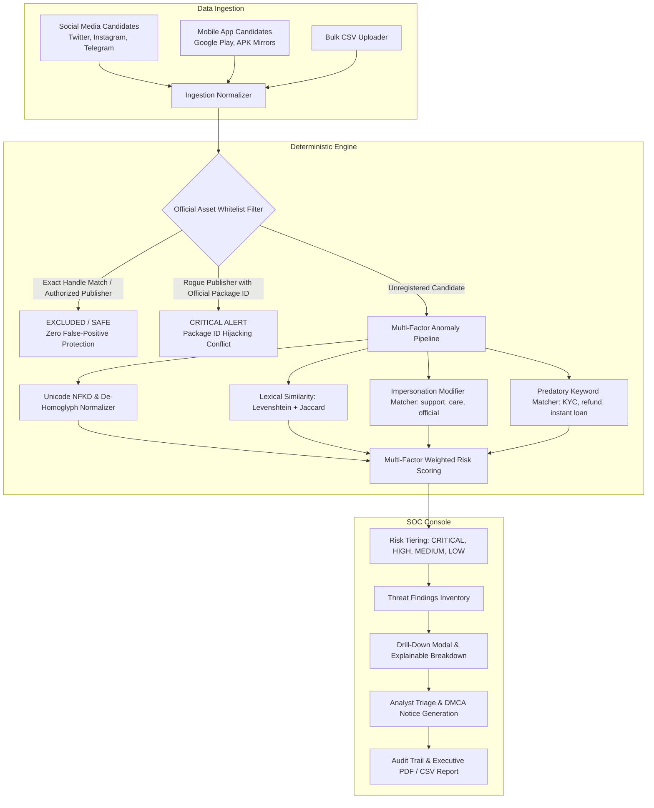

# BrandShield AI — Digital Risk Protection Platform

<div align="center">


**Real-Time Autonomous Social Media Monitoring & Mobile App Store Digital Risk Protection Platform.**

</div>

---

## 🎯 Executive Summary & Problem Statement

Organizations face unprecedented brand abuse, credential theft, and executive impersonation across decentralized digital channels:
- **Social Media Hijacking:** Threat actors spoof brands using homoglyphs (e.g. `N0vaPay`), modifier tricks (`NovaPay_Support_Care`), and transposition typos (`NovaPya`).
- **Rogue Mobile Apps:** Cybercriminals upload trojanized APKs claiming to be official wallets or instant credit portals (`NovaPay Quick Loan`), or attempt **package ID conflicts** by registering `com.novapay.app` under unauthorized developer accounts.
- **The False-Positive Dilemma:** Traditional naive scanners overwhelm SOC analysts with alerts on legitimate brand handles, authorized regional apps, and harmless unrelated businesses (e.g. `NovakBakery`).

**BrandShield AI** solves this with an **offline, explainable, deterministic detection engine** coupled with a rigorous **Official Asset Exclusion / Whitelist Framework** and a streamlined **Human-in-the-Loop SOC Triage Console**.

---

## 🌐 Quick Access URLs

| Interface | URL | Description |
| :--- | :--- | :--- |
| **BrandShield AI Web Console** | **`http://localhost:5173/`** | Full React SOC Dashboard, Triage, and Reports |
| **FastAPI Interactive Docs** | **`http://127.0.0.1:8000/docs`** | Swagger UI testing all endpoints |
| **System Health Endpoint** | **`http://127.0.0.1:8000/api/health`** | Real-time service health check |
| **Supabase Cloud Status** | **`http://127.0.0.1:8000/api/supabase/status`** | Live Supabase cloud connectivity test |

---

## ⚡ Supabase Cloud Integration

BrandShield AI is connected to Supabase for cloud telemetry, authentication, and remote synchronization:
- **Project URL:** `https://byccnjctijsbhyxyojpa.supabase.co`
- **Client SDK:** `@supabase/supabase-js v2.x` installed in frontend.
- **Client Configuration:** Located in `frontend/src/services/supabase.ts` with automatic URL normalization.
- **Security:** Uses only `VITE_SUPABASE_PUBLISHABLE_KEY` (browser-safe public key). Service role / secret keys are never exposed.
- **Status Badge:** Live "Supabase Connected" badge in the navigation bar with real-time health verification.

---

## 🚀 Exact Startup & Execution Commands

### Prerequisites
- Python 3.10+
- Node.js 18+ and npm

### Terminal 1: Start FastAPI Backend
Open a PowerShell terminal in the project directory:
```powershell
cd "c:\Users\BHARATH CHOWDARY\SOLUTION SQUAD\backend"

# If using system Python:
python -m uvicorn app.main:app --host 127.0.0.1 --port 8000 --reload

# Or if using Thonny Python installed on this machine:
& "C:\Users\BHARATH CHOWDARY\AppData\Local\Programs\Thonny\python.exe" -m uvicorn app.main:app --host 127.0.0.1 --port 8000 --reload
```
*Backend will start on `http://127.0.0.1:8000`.*

---

### Terminal 2: Start React Frontend
Open a second PowerShell terminal in the project directory:
```powershell
cd "c:\Users\BHARATH CHOWDARY\SOLUTION SQUAD\frontend"

# Ensure Node.js is in PATH and launch Vite dev server:
$env:PATH = "C:\Users\BHARATH CHOWDARY\nodejs;" + $env:PATH
& "C:\Users\BHARATH CHOWDARY\nodejs\npm.cmd" run dev
```
*Frontend will start on `http://localhost:5173/`.*

---

### Terminal 3: Run Automated Tests
```powershell
cd "c:\Users\BHARATH CHOWDARY\SOLUTION SQUAD"
& "C:\Users\BHARATH CHOWDARY\AppData\Local\Programs\Thonny\python.exe" -m pytest -v backend/tests
```
**Result:** 19 automated tests pass with 0 errors.

---

## 🏗️ Platform Architecture



---

## 🔬 Explainable Deterministic Algorithms (Zero Paid APIs)

BrandShield AI runs **100% locally and deterministically** without black-box AI hallucinations or external API keys:

1. **Unicode NFKD & Homoglyph Normalizer (`app/detection/homoglyph.py`):**
   - Transliterates Cyrillic, Greek, mathematical lookalikes (`а` -> `a`, `о` -> `o`, `ν` -> `v`).
   - Reverses leetspeak substitutions (`0` -> `o`, `1` -> `l`, `5` -> `s`, `@` -> `a`).
   - Strips zero-width characters and spaces (`\u200b`, `\u200c`).

2. **Lexical Edit & Token Distance (`app/detection/similarity.py`):**
   - **Normalized Levenshtein Distance:** Character-level edits calculated dynamically.
   - **Jaccard Token Overlap:** Word-level n-gram set intersection over union.
   - **Substring Identity Bonus:** Guarantees candidates embedding root brands (e.g. `novapaysupportcare`) receive appropriate risk weighting.

3. **Impersonation Modifier Analyzer (`app/detection/keywords.py`):**
   - Detects brand abuse affixes: `support`, `official`, `helpdesk`, `care`, `pay`, `service`, `verify`, `security`, `team`.

4. **Predatory Intent Detection:**
   - Detects phishing vectors: `urgent kyc`, `account suspended`, `instant loan`, `enter otp`, `claim refund`, `unlimited cash`.

5. **Official Asset Exclusion Framework (`app/detection/exclusion.py`):**
   - Verifies verified handle whitelists (`@NovaPay`).
   - Verifies mobile package IDs (`com.novapay.app`) against authorized publisher registries (`NovaPay Technologies Ltd`).
   - If a rogue developer registers an official package ID, the engine raises an **instant Critical Identity Conflict Alert** instead of suppressing it.

---

## 🎬 1-Click Fictional Demo ("NovaPay")

BrandShield AI includes a pre-packaged synthetic dataset for the fictional fintech company **NovaPay** (`novapay.io`):

| Target Candidate | Vector | Engine Detection | Assigned Risk |
| :--- | :--- | :--- | :--- |
| `NovaPay Wallet Pro - Unlimited Transfer` | Mobile App | **Package ID Hijack Conflict** (`com.novapay.app` by unauthorized dev `ShadowNet`) | **CRITICAL** |
| `N0vaPay_Official` | Twitter / X | Leetspeak homoglyph (`0` for `o`) + official modifier | **CRITICAL** |
| `NovaPay Quick Loan - Instant Cash` | Mobile App | Brand leveraging + Predatory instant credit terms | **CRITICAL** |
| `NovaPay_Support_Care` | Twitter / X | Phishing affixes (`support`, `care`) + urgent KYC bio | **HIGH** |
| `Guide for NovaPay Transfers` | Mobile App | Third-party informational app | **MEDIUM** |
| `NovaPya_Global` | Instagram | Character transposition typo (`Pya` vs `Pay`) | **MEDIUM** |
| `NovaPayersFan` | Telegram | Fan / community club page | **MEDIUM** |
| `NovakBakery` | Twitter / X | Harmless phonetic homograph (legitimate business) | **LOW / SAFE** |
| `SuperNova Galaxy Armada 3D` | Mobile App | Legitimate unrelated mobile game | **LOW / SAFE** |
| `@NovaPay` & `com.novapay.app` | Verified Channels | **Official Asset Exclusion Whitelist** | **EXCLUDED (0 Alerts)** |

### Synthetic Demo vs Live Data Distinction:
In the UI, all synthetic demo candidates and alerts are clearly highlighted with a purple **`[DEMO]`** badge, while manually created or CSV uploaded entities display a green **`[LIVE]`** badge.

---

## 🖥️ User Interface & SOC Console

- **SOC Dashboard:** Real-time attack surface metrics, severity distribution meters, platform breakdown, and priority alert feeds.
- **Threat Findings & SOC Triage:** Searchable threat inventory with filters by Risk Tier (`Critical`, `High`, `Medium`, `Low`) and Review Status (`Unreviewed`, `Reviewed`, `Escalated`, `False Positive`).
- **Drilldown Investigation Modal:** Detailed algorithmic breakdown (Levenshtein score, visual homoglyph diffs, modifier badges, captured evidence payloads) and analyst notes.
- **Social Media Monitoring:** Monitored social profiles, CSV uploader, and manual entry forms.
- **Mobile App Store Monitoring:** Mobile application monitoring with package ID conflict flags and CSV ingestion.
- **Protected Assets (Whitelist):** Whitelist management showcasing zero false-positive immunity.
- **Scan History:** Audit trail of scan runs, latencies, and excluded entity counts.
- **Executive Intelligence Brief:** One-click printable PDF view and CSV export for executive presentations.

---

## 💾 Database Persistence Verified

The application stores all data in SQLite (`brandshield.db`). All registered brands, official whitelist assets, candidate profiles, findings, scan histories, and analyst reviews persist across full application restarts.

---

## 🏆 Hackathon Presentation Reference
See **`walkthrough.md`** for the **3-Minute Word-for-Word Judge Presentation Script**.
